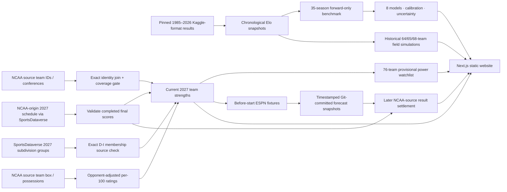

# MARCH FORECAST

**Know the numbers. Question the models. Forecast the madness.**

[](https://github.com/dokeefe414/March-Madness-Forecasting/actions/workflows/ci.yml)
[](https://github.com/dokeefe414/March-Madness-Forecasting/actions/workflows/deploy-pages.yml)
[](https://github.com/dokeefe414/March-Madness-Forecasting/actions/workflows/monitor-archive.yml)


### [OPEN GAME CENTER — FIND A REAL GAME](https://dokeefe414.github.io/March-Madness-Forecasting/)

[Find a Game](https://dokeefe414.github.io/March-Madness-Forecasting/?view=games) · [Real Accuracy & Picks](https://dokeefe414.github.io/March-Madness-Forecasting/?view=predictions) · [Model Lab](https://dokeefe414.github.io/March-Madness-Forecasting/?view=models) · [v0.9 model science](docs/v09-model-validation.md) · [v0.9 operations](docs/v09-forecast-operations.md) · [Game Center](docs/game-center.md) · [Forward accuracy](docs/forward-performance.md) · [State-space research](docs/state-space.md) · [Research models](docs/model-zoo-v06.md) · [Nightly outcome retraining](docs/online-retraining.md) · [Data quality](docs/identity-and-conferences.md) · [Pregame audit + integrity checks](docs/forecast-audit.md) · [2027 field watchlist](docs/selection-watchlist.md) · [Architecture](docs/architecture.md)

March Forecast is an open-source NCAA men's basketball forecasting and model-evaluation platform. It combines **current source-backed 2026–27 results**, season-by-season rating trajectories, **eight explicitly evaluated forecasting algorithms**, true possession-based team metrics where NCAA box scores exist, a 76-team field-watch scenario, source-timestamped pretipoff prediction tracking, and a historically grounded tournament simulator. The experience is a bespoke, responsive, dark-themed sports analytics studio.

> **Scientific trust is part of the product.** Actual results, historical backtests, NCAA-source team/conference membership, hypothetical selection scenarios, and future pretipoff predictions always have different labels. No invented March participants or scores. No "D-I certified" label from a name match. No promise that a more complex model will win.

---

## v1.3 — Forecast reliability, learned research challengers and two-player brackets

**Start here:** [Live Game Center](https://dokeefe414.github.io/March-Madness-Forecasting/?view=games) · [Operations & immutable picks](https://dokeefe414.github.io/March-Madness-Forecasting/?view=predictions) · [Scientific Model Lab](https://dokeefe414.github.io/March-Madness-Forecasting/?view=models) · [Two-player historical bracket duel](https://dokeefe414.github.io/March-Madness-Forecasting/?view=bracket) · [Team Intel](https://dokeefe414.github.io/March-Madness-Forecasting/?view=teams).

- **Source-first operational transparency:** source-capture freshness, ESPN coverage, repeated immutable snapshots, pending independently verified finals, and observed changed scheduled start times appear in an accessible Operations Center. Re-scheduled/canceled statuses are never guessed; the original first-pick evidence remains immutable.
- **Substantial new ML research:** actual fitted, previous-date **12-tree depth-two gradient-boosted CART**, with explicit fixed regularization and refits; plus a sequential **approximate Gaussian Bayesian Bradley–Terry** team-strength filter. Both are scored against Elo on identical date-frozen retrospective games, and neither can silently become a live model.
- **Head-to-head bracket competition:** independent Player A and Player B picks in the same verified historical seeded bracket, per-round matchup comparison, Elo-favorite reference decisions, local device saving, and optional shareable duel link. No online account or invented 2027 official bracket is involved.
- **Visual research workbench:** date-frozen model error curves, actual archived first-pick rolling error, calibration confidence versus wins, and interactive team Elo-strength trajectories with distinct evidence labels.
- **Mobile/polish:** quick large-tap Games/Teams/Accuracy/Brackets shortcuts, deep links and working browser back/forward, responsive source evidence cards, preserved PWA support and keyboard navigation.

**Read the mathematical definitions, limitations, operations recovery procedures and verification:** [v1.3 research + tournament operations guide](docs/v13-research-tournament-operations.md). CI tests code; real-world predictive improvement must be earned on independent future-game predictions and verified finals, not inferred from historical backtests.

---

## v1.2 — Verified results, team intelligence, model evidence and bracket building

**Go straight to what matters:** [Today's games](https://dokeefe414.github.io/March-Madness-Forecasting/?view=games) · [Team intelligence](https://dokeefe414.github.io/March-Madness-Forecasting/?view=teams) · [Real prediction accuracy](https://dokeefe414.github.io/March-Madness-Forecasting/?view=predictions) · [Fair model comparisons](https://dokeefe414.github.io/March-Madness-Forecasting/?view=models) · [Build a historical bracket](https://dokeefe414.github.io/March-Madness-Forecasting/?view=bracket).

- **Settlement investigation:** public source-derived backlog separates future, recently started, independently unresolved and 48h+ delayed archived games. The pregame recorder now retries the oldest unresolved fixture dates up to 45 days back with a bounded ESPN budget. It never invents scores or counts prospective picks before a matching, independently verified final.
- **Teams workspace:** searchable, shareable 2026–27 team pages combine actual NCAA results, Elo trajectories, sourced efficiency/pace, recent opponents, and upcoming verified fixtures. Missing source metrics remain blank.
- **Model lab:** a unified table compares actual first-published, source-settled paired model probabilities on the same games, including Brier differences, date-block confidence intervals when the sample supports them, and calibration bins. Original validation gates are preserved.
- **Make your own tournament bracket:** pick play-in and later round winners in a complete sourced historical field; save locally, reset and share a scenario link. This does not fabricate the unselected 2027 NCAA tournament.
- **Accessible mobile/installable site:** responsive cards, stable shareable tabs, keyboard skip navigation and an HTTPS-scoped progressive web app shell. Real forecast JSON is network-only, never served from an offline cache.

**Technical specification and testing:** [v1.2 implementation, data provenance and acceptance criteria](docs/v12-team-and-accuracy.md). Green CI verifies code; only actual source-backed recorded finals verify live forecast outcomes.

---

## v1.1 — Daily basketball intelligence and verified forecast operations

**Live website:** [Open daily forecast desk](https://dokeefe414.github.io/March-Madness-Forecasting/?view=games) · [Real scored picks](https://dokeefe414.github.io/March-Madness-Forecasting/?view=predictions) · [Causal research and drift](https://dokeefe414.github.io/March-Madness-Forecasting/?view=models) · [Road to March](https://dokeefe414.github.io/March-Madness-Forecasting/?view=selection).

- A faster daily front page surfaces today's source-backed future fixtures, strongest favorites, closest model calls, verified archive health and one-tap navigation to detailed matchup receipts.
- Successful archive runs always publish a dated derived manifest with source coverage, even on legitimately empty schedule days. GitHub Pages also rebuilds after a successful archive workflow to shorten the lag before picks are visible. Git pushes retry safely without a force update; monitors distinguish true empty days from missing/stale/partial evidence.
- Two **research-only** current-season causal challengers—Bayesian-style Elo shrinkage and online gradient residual stumps—are independently compared with previous-date Elo on the same previously completed games. No model is automatically promoted.
- Prospective 50-game drift review compares consecutive, nonoverlapping 25-game Brier windows using only independently settled, original pretipoff first picks. Insufficient samples show no numerical claim.
- Road to March highlights source-qualified provisional strength leaders and hypothetical neutral-site Elo peer matchups; no official field, seeds, or championship chances are invented.
- Accessibility improvements: skip link, direct destinations, mobile-first cards and source-freshness notices.

**Validation matters:** a green site deployment is *not* proof that the scheduled pregame recorder has captured and independently settled live games. Inspect the immutable Git ledger and the archive monitor to verify real production evidence. Details, mathematical assumptions, safe recovery and test commands: [v1.1 science + operations](docs/v11-season-intelligence.md).

---

## v1.0 — Prediction intelligence, transparent accuracy and scenario sensitivity

**What is new:** The real Game Center now exposes a source-grounded **team-vs-team strength and adjusted-efficiency comparison** with honest missing-data handling. `Accuracy & Picks` includes **exclusive favorite confidence cohorts**, **25-game chronological forward Brier**, and **Brier skill relative to a 50/50 reference** (including negative results when the public forecasts underperform). The historical Bracket Lab offers a **one-team ±150 Elo sensitivity experiment** with same-seed, same-run paired Monte Carlo simulations and championship probability deltas.

The underlying predictions and rules remain unchanged unless verified forward results justify a pre-existing gated promotion: no invented 2027 bracket, no results leaked into pregame odds, no fake success rate when zero first-archived forecasts have settled, and no turning descriptive efficiency numbers into coefficients.

**Explore:** [Game evidence](https://dokeefe414.github.io/March-Madness-Forecasting/?view=games) · [Prospective performance](https://dokeefe414.github.io/March-Madness-Forecasting/?view=predictions) · [Bracket sensitivity lab](https://dokeefe414.github.io/March-Madness-Forecasting/?view=bracket) · [Full v1.0 methods, tests and runbook](docs/v10-prediction-intelligence.md).

---

## v0.9 — Prove every real game forecast, then adapt responsibly

The entry screen is still **Find a Game**. Choose a real source-matched future ESPN matchup, search by **school** or select a team directly from **2027 Pulse**, and see:

- The **actual home/away win percentage** and which model supplied the headline forecast.
- Why earlier opponents matter: a team's own sequence of sourced results, pregame Elo, recent form, home-court assumption, common opponents, head-to-head history and a **new opponent-strength-adjusted score-margin candidate**.
- Small season Elo curves for both teams, explicit research-only fixed/adaptive Gaussian probabilities, and whether either latent team is showing **repeated innovation drift-watch** evidence.
- A **shareable `?view=games&game=<ESPN event ID>` deep link** and quick jumps to the independent model lab and honest accuracy history.
- After the game finishes and independent source verification passes, the **original archived percentage next to its real final score**, missed/correct status, Brier score and a chart of how its actual earlier public captures evolved.

**The scorecard cannot manufacture accuracy.** `Accuracy & Picks` uses only the earliest legitimate Git-archived before-tipoff forecast for each unique ESPN event and subsequent finalized source result. There is no success rate until such games have settled; `—` is intentional, not 0% or a perfect record. Model Lab shows real paired same-game Brier/accuracy and distinct retrospective date-frozen experiments without mixing cohorts. Research models are not automatically promoted because an isolated high-confidence favorite lost.

**A missed forecast becomes future information, not a revision of history.** On subsequent scheduled builds, previous-date games update Elo, logistic coefficients and independent opponent-aware/adaptive state-space research. The current Eastern game date remains embargoed. The online logistic model needs *both* chronological out-of-time evaluation **and** at least 40 truly archived first-pick paired games with a prospective Brier advantage before taking over new eligible regular-season games. Opponent-aware and adaptive Kalman variants stay research-only until separately validated; no guaranteed performance gain is claimed.

**Reliability upgrade:** a result is settled only if the NCAA-derived score agrees with an *independently completed ESPN `STATUS_FINAL`* for the very same event ID, scheduled Eastern date, and exact home/away scores. A score mismatch, postponement, unfinished event or missing source stays unscored. The separate archive monitor flags a missing/stale/no-pick ledger and the website displays its state instead of implying success.

**Already configured, Eastern local time (EST/EDT):** 1:00 a.m. ratings/model/site refresh; 5:17 a.m. in-season catch-up; 9:07 a.m. and 4:07 p.m. in-season genuine pregame archiving; 10:17 a.m. and 5:17 p.m. website republishing; 11:35 a.m. and 6:35 p.m. archive-health checks. GitHub and sports-source schedules are best effort, not streaming real-time service.

**Quick access:** [Find a real game](https://dokeefe414.github.io/March-Madness-Forecasting/?view=games) · [Real winner accuracy](https://dokeefe414.github.io/March-Madness-Forecasting/?view=predictions) · [Compare models](https://dokeefe414.github.io/March-Madness-Forecasting/?view=models) · [Check public archive health](https://dokeefe414.github.io/March-Madness-Forecasting/current/archive-health.json) · [Read the science](docs/v09-model-validation.md) · [Daily runbook and recovery](docs/v09-forecast-operations.md).

---

## Original v0.6 research foundations (preserved)

| Area | New capability | What it does *not* claim |
| --- | --- | --- |
| **NCAA source identity** | Exact 2027 team ID/conference crosswalk **plus independent 2027 Division I subdivision membership evidence**; matched/unmatched coverage, conference filters | D-I source group membership is verified separately; neither membership nor a conference name certifies individual postseason eligibility |
| **True pace stats** | Opponent-regularized per-100-possession offense, defense, net and pace from real NCAA-derived team box rows | Descriptive efficiency is not yet a historically trained win-probability model |
| **Strong prediction research** | Seven baseline/learned methods plus a prior-year-tuned **probability ensemble**; boosted Elo, causal EWMA, uncertainty, full walk-forward validation | Out-of-time historical results do not guarantee success in the upcoming season |
| **Real pregame evidence** | Scheduled future ESPN fixtures, conservative identity matching, strict pretipoff creation timestamps, immutable Git-published picks, later NCAA-score settlements | A scheduled ESPN start is not independently verified actual tipoff; no past picks are backfilled |
| **2027 selection watch** | 32 conference-leader *proxies*, 44 rating-based at-large *proxies*, 16 near-cutline candidates, wide illustrative strength tiers — **only if crosswalk coverage permits** | Not a committee bracket, NCAA NET, probability of a bid, conference champion, or real seed |
| **Premium visuals and QA** | Nine-tab responsive site, interactive Elo histories, possession profiles, source status cards, new selection/audit pages, Playwright desktop + mobile tests, axe critical WCAG checks | Visual smoke checks are not a complete human or screen-reader audit |

The existing **42-year historical archive (1985–2026)**, historical matchup laboratory, actual tournament-result explorer, and **64/65/68/76** full-field Monte Carlo tournament format are preserved. The official 2027 men's field is **76 teams** including **12 Opening Round games** before the main 64-team bracket; it has not been selected yet. [Official NCAA explanation](https://www.ncaa.com/news/basketball-men/article/2026-05-07/how-2027-expanded-ncaa-tournament-and-march-madness-brackets-will-work).

## Model performance: results, not slogans

The historical tournament benchmark scores the **same 2,270 games from 35 held-out tournament seasons (1990–2025)** for every model, training or tuning only with earlier seasons. Canceled 2020 and the incomplete 2026 regular-season archive are excluded.

| Model | Brier ↓ | Log loss ↓ | Accuracy |
| --- | ---: | ---: | ---: |
| Coin flip | 0.2500 | 0.6931 | 50.0% |
| Standard Elo | 0.2225 | 0.6360 | 63.6% |
| Form-adjusted Elo | 0.2240 | 0.6391 | 63.5% |
| Adaptive regime/EWMA | 0.2274 | 0.6460 | 62.0% |
| Calibrated Elo | 0.2207 | 0.6296 | 63.5% |
| L2 logistic regression | 0.2291 | 0.6506 | 63.2% |
| **Boosted Elo** | **0.2181** | **0.6255** | 63.6% |
| Earlier-heldout-year ensemble | 0.2205 | 0.6296 | 63.6% |

**Boosted Elo currently has the best Brier score in the historical test.** The more complicated adaptive and logistic baselines actually perform worse than standard Elo; their results stay visible. Statistical uncertainty must be judged against the season-block 95% intervals in the dynamically generated research report. The 2027 source is separate from historical Kaggle data; possession-based 2027 statistics are **not quietly inserted into these backtests**. This is scoring on already-realized historical *matchups*, not a proven historical ability to select or fill NCAA brackets.

[Full math, model cards and reproducibility](docs/model-zoo-v06.md) · [Earlier technical benchmark specification](docs/rolling-benchmark.md)

## Explore the application

**2027 Pulse** displays NCAA-source finals, independent 2027 Elo ratings, actual team history, a causal volatility/regime signal, confirmed crosswalk confidence and optional box-score possession estimates. The matchup tool can compare base Elo with historically calibrated/ensemble *scenarios* when that calibration report exists. It explicitly flags that March-neutral calibration was not validated for regular-season home games.

**Field Watch** creates a **hypothetical** 76-team, 32-conference power-based field only when the source independently verifies a team’s 2027 Division I subdivision **and** exact NCAA-source conference identity. Early-season conference leaders are strength proxies, not official championship bids; wide seed tiers describe heuristic relative strength, not seed odds. If coverage is incomplete, the dashboard says so and displays no fake participants.

**Picks Ledger** reads immutable, Git-committed pretipoff probability files. Once the scheduler has really captured matches, it shows forecast date versus listed start, exact event IDs, original predictions, and independently settled Brier/winner results. Before then it shows **no audited forecast archive yet**, not generated hindsight "picks."

**Historical Rankings and Matchup Lab** retain 42 season snapshots, sortable/searchable model rankings and frozen historical neutral matchup scenarios. **Bracket Lab** reconstructs actual historical seed placements, simulates play-ins and every tournament round, and supports **76-team field format** only after verified 2027 seeds become available. **Research Lab** offers eight methods, interactive favorite-confidence reliability plots, per-year model coefficients, game-weighted aggregate scores and paired season-bootstrap intervals. **Archive and About** preserve real historical tournament outcomes and transparent limitations.

## How the engine works



This separation is intentional: **historical Kaggle numeric IDs**, 2027 NCAA-source names/IDs, and ESPN event IDs are different provenance domains. Exact source-linked mapping is required before joining; a display-name similarity is not enough. A second season-specific subdivision membership source and published **2026–27 NCAA-to-ESPN ID crosswalk**, with dated NCAA-name alias fallback, support verifiable D-I candidate flags without guessing mascot/school matches.

## Quickstart (Windows / VS Code)

Requires **Python 3.11+**, **Node 22**, npm, and Git. From PowerShell in the repository root:

```powershell
git clone https://github.com/dokeefe414/March-Madness-Forecasting.git
cd March-Madness-Forecasting
$env:PYTHONPATH="research"

# Offline, deterministic unit suite; no data provider account needed
py -m unittest discover -s research/tests -v

# Generate earlier-year-trained model report
py -m forecast.benchmark --web-dir web --out web/public/research/benchmark.json

# Download validated 2027 NCAA-origin scores, team IDs and possession boxes
py -m forecast.live --model-report web/public/research/benchmark.json --out web/public/current/2027.json

cd web
npm install
npm run check:data
npm run test:bracket
npm run typecheck
npm run dev
```

Open [http://localhost:3000](http://localhost:3000). To make production artifacts, run `npm run build`. On Linux/macOS, use `python3` and `export PYTHONPATH=research`. Internet access is needed only for fetching current public 2027 source data; historical archives, scientific tests and bracket unit tests are self-contained. If the optional team directory/box source is unavailable, actual score-derived ratings can still be generated with **explicit source-unavailable** flags; no placeholders are fabricated.

For real browser visual and keyboard checks:

```powershell
cd web
npx playwright install chromium
npm run test:e2e
```

On Windows, ensure the Playwright web-server Python command works; see [browser QA guide](docs/browser-quality.md) for the `py -m http.server` alternative. CI runs Chromium against the static `web/out` export, rather than dev-server HMR.

### Run a fixture-only pregame ledger check

```powershell
$env:PYTHONPATH="research"
py -m unittest research.tests.test_snapshot -v
py -m unittest research.tests.test_v06_data -v
```

These fixtures **never** become real game forecasts. Production ledger archiving requires a scheduled job to observe a genuine future fixture and commit the pick **before** the listed start.

## Automation and publishing

| Workflow | Schedule and purpose |
| --- | --- |
| [CI](https://github.com/dokeefe414/March-Madness-Forecasting/actions/workflows/ci.yml) | Python scientific/fixture tests, 8-model benchmark artifact, source data integrity, TS bracket tests, TypeScript+build, **Playwright desktop/mobile and critical accessibility checks** |
| [Pages deploy](https://github.com/dokeefe414/March-Madness-Forecasting/actions/workflows/deploy-pages.yml) | On `main` changes, manual run, **1:00 a.m. Eastern every night** (EST/EDT), and **5:17 a.m. Eastern** Nov–Apr catch-up. Build historical calibration, fetch NCAA 2027 source/box/directory, output static Next site |
| [Pregame archive](https://github.com/dokeefe414/March-Madness-Forecasting/actions/workflows/archive-pregame.yml) | On main, manual or best-effort daily **9:07 a.m. Eastern** Nov–Apr. Fetch future ESPN fixtures, emit real *pre-start* picks, later settle against NCAA finals, commit append-only public history |

Scheduled GitHub Actions may be delayed/omitted. A source outage must not fabricate scores, and an unarchived future fixture is not a historical prediction. The Pages site's last successful build remains available if a mandatory source fetch fails. **Archiver commits require branch/workflow write permissions**, which may need operator changes if an organization has protected main.

### Git-committed proof versus build artifacts

- `web/public/seasons/` and `web/public/tournaments/`: **committed historical** source-derived archival data.
- `web/public/forecasts/snapshots/` and `settlements/`: **immutable append-only public Git** archives created when real scheduled future fixtures and later confirmed finals are available. `index.json` is a derived dashboard view.
- `web/public/current/2027.json`: generated **during deployment**, gitignored to avoid stale daily sources.
- `web/public/research/benchmark.json`: generated reproducible report, gitignored.
- `web/out`: static Next.js export used for GitHub Pages; not primary data.

Current hosted address: **https://dokeefe414.github.io/March-Madness-Forecasting/**. A Pages run requires Settings → Pages → Source **GitHub Actions**.

## Repository structure

```text
research/forecast/
  core.py                 chronological Elo updates and baseline probability
  advanced.py             L2 regularized matchup logistic model
  boosted.py              deterministic second-order residual decision stumps
  dynamics.py             causal EWMA, volatility and regime change signal
  retrain.py              in-season logistic retraining and genuine forward promotion gates
  gamecenter.py           source-verified ESPN schedule, matchups, prior-game reasons
  opponents.py            causal surprise margins relative to prior-date opponent Elo
  archive_health.py       scheduled archive freshness and missing-data monitor
  performance.py          one-first-pick-per-game accuracy, confidence and miss reports
  state_space.py          causal Gaussian skill, uncertainty and shock experiments
  benchmark.py            eight-method prior-year walk-forward NCAA evaluation
  reference.py            exact NCAA-source 2027 conference/name crosswalk
  division.py             independent 2027 D-I subdivision + season-specific NCAA/ESPN source crosswalk
  efficiency.py           true possession-based opponent-adjusted team strength
  selection.py            32+44 provisional strength watchlist and seed tiers
  live.py                 validated 2027 results and supplemental source imports
  snapshot.py             pretipoff fixture/P(G) ledger and later NCAA settlement
  history.py              Kaggle-format frozen historical archives
  download.py             pinned source download and SHA validation
research/tests/           hermetic unit, leakage, integrity and fixture tests
web/
  components/
    Dashboard.tsx         nine-tab historical and current application
    LiveSeason.tsx        team trends, pace profile, conferences, matchup tools
    OnlineLearning.tsx    live in-season model scorecard, gate and source report
    GameCenter.tsx        default game-first browse/search and why-the-pick report
    ForwardScorecard.tsx  unique-game forward accuracy, model results and misses
    ModelLab.tsx          forward paired Brier and strictly dated research comparisons
    GameAudit.tsx         individual-game public probability history and verified final receipt
    SelectionLab.tsx      transparent 2027 power-only watchlist
    ForecastTracker.tsx   public pretipoff audit trail, Brier/accuracy dashboard
    TeamTrend.tsx         keyboard-interactive game-by-game Elo trend SVG
    FullBracketLab.tsx    sourced historical-field Monte Carlo simulator
    ResearchLab.tsx       eight-method model scores, reliability and uncertainty
  lib/fullBracket.ts      64,65,68,76 tournament formats and seeded RNG
  e2e/                   Playwright browser interaction and mobile QA
  public/forecasts/       append-only audited forecasts when published
  public/current/2027.json  build-generated, not committed
  public/research/benchmark.json build-generated, not committed
  public/seasons/         frozen historical team-rating records
  public/tournaments/     official historical NCAA results and seeds
docs/                     complete scientific, design, data and operator docs
.github/workflows/         CI, Pages deploy, chronological score/pick archive
```

## Documentation index

| Topic | Reference |
| --- | --- |
| **Eight models, equations, prior-year fitting, measured results** | [Model zoo & validation](docs/model-zoo-v06.md) |
| **Nightly fitting, previous-date evaluation and model promotion** | [In-season retraining](docs/online-retraining.md) |
| **Pick a real game and inspect other games behind its prediction** | [Game Center](docs/game-center.md) |
| **True before-tipoff accuracy, calibration and missed-call reviews** | [Forward accuracy](docs/forward-performance.md) |
| **Gaussian uncertainty and shock-aware time-series experiment** | [State-space research](docs/state-space.md) |
| **Exact NCAA team identity/confidence and eligibility limits** | [Identity & conferences](docs/identity-and-conferences.md) |
| **Source possession formulas and opponent adjustment** | [Adjusted efficiency](docs/adjusted-efficiency.md) |
| **2027 field coverage gate, bubble and strength tiers** | [Selection watchlist](docs/selection-watchlist.md) |
| **Pre-start time guards, append-only snapshots and result settlement** | [Forecast audit](docs/forecast-audit.md) |
| **Browser tests, mobile overflow, accessibility and trace artifacts** | [Browser quality](docs/browser-quality.md) |
| Original Elo baseline and 0.5 validation | [Validation overview](docs/validation.md) |
| Current 2027 NCAA-source ingestion and schema problems | [Current season](docs/current-season.md) |
| Historical and generated data contracts | [Data contract](docs/data-contract.md) |
| Historical field formats and limits | [Bracket engine](docs/bracket-engine.md) |
| Engineering architecture and data flow | [Architecture](docs/architecture.md) |
| CSS tokens, layouts, interaction and accessibility | [Design system](docs/design-system.md) |
| GitHub Actions scheduling, failures, CI and Pages | [Operations](docs/operations.md) |
| Earlier rolling-year benchmark baseline | [Rolling benchmark](docs/rolling-benchmark.md) |
| Python CLI and research modules | [Research guide](research/README.md) |

## What remains a research challenge

**There is no authenticated official 2027 field before Selection Sunday.** The selection watchlist is explicitly power-only. Conference mapping **and D-I subdivision membership** are independently sourced but neither is an individual postseason eligibility certification, and current team-box statistics have not been historically evaluated for game probabilities. The pretipoff audit does not have an invented backlog: it will become populated only if actual future fixtures can be matched and archived in time. ESPN's scheduled time is not independent proof of actual tipoff; results are settled conservatively by verified NCAA final-score game identities.

The first complete v0.6 release prioritizes **evidence, trust, usable visuals and reproducible code**. Future work should backtest real committee/resume/NET selection prediction, secure truly historical possession-by-possession crosswalks, measure 2027 forward model drift, and evaluate injury/transfer-aware features only when real source data and redistribution rights are available.

---

**Built in public. Auditable by design.** Visit the [GitHub issues](https://github.com/dokeefe414/March-Madness-Forecasting/issues) for feature proposals and scientifically reproducible corrections.

## v0.6 data-quality correction: conference groups vs labels

The production 2027 sources now **directly verify 365 D-I teams** through the official same-season NCAA-to-ESPN ID crosswalk. The NCAA directory returns **31 distinct conference display strings**, even though the separate season-2027 verified Division I membership records encode **32 distinct conference group IDs**. Treating a display label as a conference identity therefore incorrectly suppressed the hypothetical 32-AQ field. The field watchlist now groups *only* source-confirmed D-I members by their authoritative 2027 `divisionConferenceGroupId`, retains human-friendly NCAA directory names for display, and reports the number of group IDs versus display-name counts separately. Two different source groups may display similar labels without being merged. Unmatched or unverified teams still cannot enter the power-only scenario. See [watchlist methodology](docs/selection-watchlist.md) and [identity contracts](docs/identity-and-conferences.md).

## Independent pretipoff ledger verification (v0.6.1)

The user-facing `Forecast Tracker` is backed by immutable source-timestamped snapshot files plus later result-settlement files; a visual chart alone is **not** evidence of a real published prediction. To independently check every committed record and recompute scoreboard metrics:

```powershell
$env:PYTHONPATH="research"
py -m forecast.audit --dir web/public/forecasts
```

The integrity audit confirms: 15-minute pregame publication buffer, source rating not newer than forecast generation, forecast probabilities preserved during settlement, binary observed winner consistent with final scores, correct Brier/log-loss/accuracy, uniqueness of settlement, and public aggregate scores matching actual files. It runs on every GitHub Actions archival capture and every CI pull request before allowing publication. A report with zero snapshots is a **valid empty archive**, not evidence of past public forecasts. External source truth and actual tipoff times are not independently guaranteed. Full details: [Forecast audit](docs/forecast-audit.md).

## Nightly 1:00 a.m. Eastern automated updates

**Yes — the website schedules a source refresh every night at 1:00 a.m. `America/New_York`, automatically respecting EST and EDT.** GitHub Actions does not guarantee second-accurate execution, so the job may start late or occasionally be dropped. While NCAA basketball is in season (November–April), a **5:17 a.m. Eastern follow-up** gives late West Coast games and delayed upstream score publications another opportunity to reach the site. The standalone pretipoff archival workflow runs at **9:07 a.m. Eastern** in-season to capture upcoming fixture probabilities and grade earlier predictions; it never backfills fake prior pregame picks.

At each site refresh the pipeline:

1. Rebuilds the held-out historical research/calibration report from pinned archives.
2. Fetches the **latest available** NCAA-derived 2027 schedule and final-score subset; recalculates all team **wins, losses, Elo, form, conference/D-I matches, possession-derived statistics where available**, watchlist and matchup probabilities.
3. Refuses to publish if required source fetch, score validation or computed model/accounting checks fail. `forecast.freshness` audits source UTC retrieval, accepted-game win/loss totals, unique team IDs, pregame diagnostic counts and latest result date.
4. Produces a machine-readable [refresh status](https://dokeefe414.github.io/March-Madness-Forecasting/current/refresh-status.json) showing source time, newest included game, program/game counts and source lag; `source-may-be-delayed` is a visible warning, not a fabricated result.
5. Rechecks the append-only pregame audit, validates historical files and builds/deploys the static site. If deployment fails, the previous successful GitHub Pages version stays available.

**Important:** A 1:00 a.m. refresh is **not** a live real-time scoreboard, and some late-night games may still be underway. The public schedule does not supply a guaranteed authoritative final-status field for every published row; games with missing, zero or tied scores are excluded, but a positive in-progress score may require confirmation. The delayed 5:17 a.m. pass reduces the risk of missed late scores; the system must not claim more certainty than its provider supports. After **Selection Sunday March 14, 2027**, this model deliberately stops including postseason results in the regular-season forecast snapshot to avoid leakage. The next NCAA season needs an explicit version/source/cutoff migration.

Monitor the [daily deployment workflow](https://github.com/dokeefe414/March-Madness-Forecasting/actions/workflows/deploy-pages.yml) and [pregame archive workflow](https://github.com/dokeefe414/March-Madness-Forecasting/actions/workflows/archive-pregame.yml). See [operations](docs/operations.md) and [current source runbook](docs/current-season.md).


## v0.7 — Automatic 2027 time-series-informed outcome retraining

Alongside automatically updating each team's Elo rating history, both the **1:00 a.m. Eastern** primary refresh and **5:17 a.m. Eastern in-season catch-up** now fit a **regularized outcome model** from sourced **previous-date** 2027 regular-season game results. The 9:07 a.m. Eastern pretipoff archiver also refits it before saving future-game probabilities.

This is different from a cosmetic time-series chart: the model's coefficients are learned from prior games and tested only on **later calendar dates**. The entire current date is excluded, and all games on any validation date are evaluated **before** that date's results update ratings. The training audit reports comparable Brier scores and day-block uncertainty.

**Conservative automatic promotion:** new coefficients train every refresh, but the model stays in **shadow mode** and genuine archived picks remain Elo until it has at least 120 validation games over 12 dates, beats Elo by 0.002 Brier on the exact same games, and has positive lower day-block confidence bound. If it clears that bar, it becomes eligible for future non-neutral pregame forecasts, with original model/version receipts stored immutably. A future failure of the gate returns new picks to Elo; old picks are never rewritten.

See the site's **Current Pulse → Automated Model Lab** section, [public 2027 learned-model report](https://dokeefe414.github.io/March-Madness-Forecasting/current/2027-online-model.json), and [methodology/validation instructions](docs/online-retraining.md). This is an in-season regular-game model, **not** an automatically retrained NCAA bracket or committee prediction engine.


## v0.8 — Game Intelligence: choose any supported real game and see why

The website now opens in **Find a Game**. The Game Center requests real future ESPN scheduled fixtures for five Eastern calendar days (updated during scheduled GitHub Actions) and matches them to independently sourced 2027 NCAA team identities. Select or search a fixture to see **home/away winning percentages, the model used, both teams' records and Elo, home adjustment, recent form, average opponent quality, five prior-date results per side, head-to-head and common-opponent comparisons**. Those earlier games influence team rating histories; common-opponent margins are not falsely double-counted as separate probability coefficients. Unknown/ambiguous source matches never receive invented odds. A separate neutral hypothetical sandbox works even when there are no future fixtures. [Game Center methodology](docs/game-center.md).

**Prediction percentage versus forecasting accuracy are distinct.** The `Accuracy & Picks` tab reports the correct-winner rate for **one earliest genuinely archived before-tipoff prediction per ESPN event**. It provides Brier/log loss, cumulative performance, model-specific percentages, reliability/confidence bins and a transparent list of missed calls. With zero real settled first-pick games, the percentage is **—**, *not* the retrospective model's accuracy or a made-up 100%. [Independent forward audit](docs/forward-performance.md).

**Misses improve future training, not past scores.** New previous-day source results enter the existing 1:00 a.m. Eastern / 5:17 a.m. catch-up pipeline. The regular-season learned model keeps its earlier-date Brier and date-block safeguards, and now additionally requires **40 unique settled pregame paired Elo-versus-challenger forecasts** with a Brier advantage >=0.002 before it can be used for future eligible games. It automatically remains in shadow/demotes to Elo without real supporting evidence. An experimental **Kalman-style Gaussian time-series filter** also models evolving team strength and observation uncertainty; it is *research-only* until prospective evidence supports it. [State-space assumptions](docs/state-space.md). No model is allowed to alter a forecast after learning the actual result.

Field Watch adds an explicitly **hypothetical neutral Elo upset-lens** for any two sourced provisional power-list candidates. This is not a 2027 official tournament bracket, seed or selection probability. The regular-season data cutoff still freezes the 2027 snapshot at Selection Sunday; a new season requires manual source/cutoff migration.

**Automation:** Site source refresh and updated model at 1:00 a.m. Eastern daily, in-season 5:17 a.m. Eastern catch-up, and 9:07 a.m. Eastern genuinely forward game archiving and source settlement. Schedule/provider delays are disclosed; this is not instantaneous live odds. [Runbook](docs/operations.md).

### Research integrity

(1) A future *single-game win probability*, (2) a retrospective *chronological backtest accuracy*, and (3) a genuine *published before-tipoff accuracy* are different quantities. The site labels each and never uses an after-game prediction as a claim of forward accuracy.
