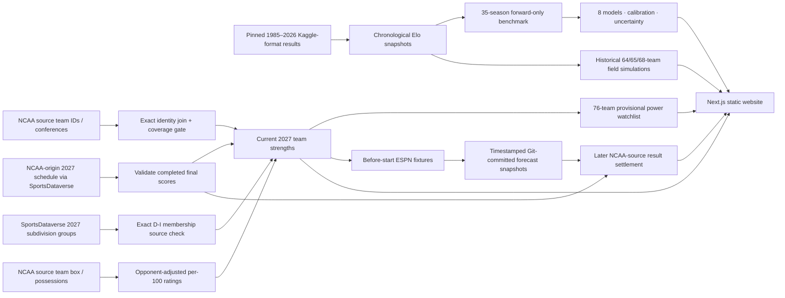

# MARCH FORECAST

**Know the numbers. Question the models. Forecast the madness.**

[](https://github.com/dokeefe414/March-Madness-Forecasting/actions/workflows/ci.yml)
[](https://github.com/dokeefe414/March-Madness-Forecasting/actions/workflows/deploy-pages.yml)


### [OPEN THE LIVE WEBSITE](https://dokeefe414.github.io/March-Madness-Forecasting/)

[Research models](docs/model-zoo-v06.md) · [Data quality](docs/identity-and-conferences.md) · [Pregame audit](docs/forecast-audit.md) · [2027 field watchlist](docs/selection-watchlist.md) · [Architecture](docs/architecture.md)

March Forecast is an open-source NCAA men's basketball forecasting and model-evaluation platform. It combines **current source-backed 2026–27 results**, season-by-season rating trajectories, **eight explicitly evaluated forecasting algorithms**, true possession-based team metrics where NCAA box scores exist, a 76-team field-watch scenario, source-timestamped pretipoff prediction tracking, and a historically grounded tournament simulator. The experience is a bespoke, responsive, dark-themed sports analytics studio.

> **Scientific trust is part of the product.** Actual results, historical backtests, NCAA-source team/conference membership, hypothetical selection scenarios, and future pretipoff predictions always have different labels. No invented March participants or scores. No "D-I certified" label from a name match. No promise that a more complex model will win.

---

## What's new in v0.6?

| Area | New capability | What it does *not* claim |
| --- | --- | --- |
| **NCAA source identity** | Exact 2027 team ID/conference crosswalk **plus independent 2027 Division I subdivision membership evidence**; matched/unmatched coverage, conference filters | D-I source group membership is verified separately; neither membership nor a conference name certifies individual postseason eligibility |
| **True pace stats** | Opponent-regularized per-100-possession offense, defense, net and pace from real NCAA-derived team box rows | Descriptive efficiency is not yet a historically trained win-probability model |
| **Strong prediction research** | Seven baseline/learned methods plus a prior-year-tuned **probability ensemble**; boosted Elo, causal EWMA, uncertainty, full walk-forward validation | Out-of-time historical results do not guarantee success in the upcoming season |
| **Real pregame evidence** | Scheduled future ESPN fixtures, conservative identity matching, strict pretipoff creation timestamps, immutable Git-published picks, later NCAA-score settlements | A scheduled ESPN start is not independently verified actual tipoff; no past picks are backfilled |
| **2027 selection watch** | 32 conference-leader *proxies*, 44 rating-based at-large *proxies*, 16 near-cutline candidates, wide illustrative strength tiers — **only if crosswalk coverage permits** | Not a committee bracket, NCAA NET, probability of a bid, conference champion, or real seed |
| **Premium visuals and QA** | Nine-tab responsive site, interactive Elo histories, possession profiles, source status cards, new selection/audit pages, Playwright desktop + mobile tests, axe critical WCAG checks | Visual smoke checks are not a complete human or screen-reader audit |

The existing **42-year historical archive (1985–2026)**, historical matchup laboratory, actual tournament-result explorer, and **64/65/68/76** full-field Monte Carlo tournament format are preserved. The official 2027 men's field is **76 teams** including **12 Opening Round games** before the main 64-team bracket; it has not been selected yet. [Official NCAA explanation](https://www.ncaa.com/news/basketball-men/article/2026-05-07/how-2027-expanded-ncaa-tournament-and-march-madness-brackets-will-work).

## Model performance: results, not slogans

The historical tournament benchmark scores the **same 2,270 games from 35 held-out tournament seasons (1990–2025)** for every model, training or tuning only with earlier seasons. Canceled 2020 and the incomplete 2026 regular-season archive are excluded.

| Model | Brier ↓ | Log loss ↓ | Accuracy |
| --- | ---: | ---: | ---: |
| Coin flip | 0.2500 | 0.6931 | 50.0% |
| Standard Elo | 0.2225 | 0.6360 | 63.6% |
| Form-adjusted Elo | 0.2240 | 0.6391 | 63.5% |
| Adaptive regime/EWMA | 0.2274 | 0.6460 | 62.0% |
| Calibrated Elo | 0.2207 | 0.6296 | 63.5% |
| L2 logistic regression | 0.2291 | 0.6506 | 63.2% |
| **Boosted Elo** | **0.2181** | **0.6255** | 63.6% |
| Earlier-heldout-year ensemble | 0.2205 | 0.6296 | 63.6% |

**Boosted Elo currently has the best Brier score in the historical test.** The more complicated adaptive and logistic baselines actually perform worse than standard Elo; their results stay visible. Statistical uncertainty must be judged against the season-block 95% intervals in the dynamically generated research report. The 2027 source is separate from historical Kaggle data; possession-based 2027 statistics are **not quietly inserted into these backtests**. This is scoring on already-realized historical *matchups*, not a proven historical ability to select or fill NCAA brackets.

[Full math, model cards and reproducibility](docs/model-zoo-v06.md) · [Earlier technical benchmark specification](docs/rolling-benchmark.md)

## Explore the application

**2027 Pulse** displays NCAA-source finals, independent 2027 Elo ratings, actual team history, a causal volatility/regime signal, confirmed crosswalk confidence and optional box-score possession estimates. The matchup tool can compare base Elo with historically calibrated/ensemble *scenarios* when that calibration report exists. It explicitly flags that March-neutral calibration was not validated for regular-season home games.

**Field Watch** creates a **hypothetical** 76-team, 32-conference power-based field only when the source independently verifies a team’s 2027 Division I subdivision **and** exact NCAA-source conference identity. Early-season conference leaders are strength proxies, not official championship bids; wide seed tiers describe heuristic relative strength, not seed odds. If coverage is incomplete, the dashboard says so and displays no fake participants.

**Picks Ledger** reads immutable, Git-committed pretipoff probability files. Once the scheduler has really captured matches, it shows forecast date versus listed start, exact event IDs, original predictions, and independently settled Brier/winner results. Before then it shows **no audited forecast archive yet**, not generated hindsight "picks."

**Historical Rankings and Matchup Lab** retain 42 season snapshots, sortable/searchable model rankings and frozen historical neutral matchup scenarios. **Bracket Lab** reconstructs actual historical seed placements, simulates play-ins and every tournament round, and supports **76-team field format** only after verified 2027 seeds become available. **Research Lab** offers eight methods, interactive favorite-confidence reliability plots, per-year model coefficients, game-weighted aggregate scores and paired season-bootstrap intervals. **Archive and About** preserve real historical tournament outcomes and transparent limitations.

## How the engine works



This separation is intentional: **historical Kaggle numeric IDs**, 2027 NCAA-source names/IDs, and ESPN event IDs are different provenance domains. Exact source-linked mapping is required before joining; a display-name similarity is not enough. A second season-specific subdivision membership source and published **2026–27 NCAA-to-ESPN ID crosswalk**, with dated NCAA-name alias fallback, support verifiable D-I candidate flags without guessing mascot/school matches.

## Quickstart (Windows / VS Code)

Requires **Python 3.11+**, **Node 22**, npm, and Git. From PowerShell in the repository root:

```powershell
git clone https://github.com/dokeefe414/March-Madness-Forecasting.git
cd March-Madness-Forecasting
$env:PYTHONPATH="research"

# Offline, deterministic unit suite; no data provider account needed
py -m unittest discover -s research/tests -v

# Generate earlier-year-trained model report
py -m forecast.benchmark --web-dir web --out web/public/research/benchmark.json

# Download validated 2027 NCAA-origin scores, team IDs and possession boxes
py -m forecast.live --model-report web/public/research/benchmark.json --out web/public/current/2027.json

cd web
npm install
npm run check:data
npm run test:bracket
npm run typecheck
npm run dev
```

Open [http://localhost:3000](http://localhost:3000). To make production artifacts, run `npm run build`. On Linux/macOS, use `python3` and `export PYTHONPATH=research`. Internet access is needed only for fetching current public 2027 source data; historical archives, scientific tests and bracket unit tests are self-contained. If the optional team directory/box source is unavailable, actual score-derived ratings can still be generated with **explicit source-unavailable** flags; no placeholders are fabricated.

For real browser visual and keyboard checks:

```powershell
cd web
npx playwright install chromium
npm run test:e2e
```

On Windows, ensure the Playwright web-server Python command works; see [browser QA guide](docs/browser-quality.md) for the `py -m http.server` alternative. CI runs Chromium against the static `web/out` export, rather than dev-server HMR.

### Run a fixture-only pregame ledger check

```powershell
$env:PYTHONPATH="research"
py -m unittest research.tests.test_snapshot -v
py -m unittest research.tests.test_v06_data -v
```

These fixtures **never** become real game forecasts. Production ledger archiving requires a scheduled job to observe a genuine future fixture and commit the pick **before** the listed start.

## Automation and publishing

| Workflow | Schedule and purpose |
| --- | --- |
| [CI](https://github.com/dokeefe414/March-Madness-Forecasting/actions/workflows/ci.yml) | Python scientific/fixture tests, 8-model benchmark artifact, source data integrity, TS bracket tests, TypeScript+build, **Playwright desktop/mobile and critical accessibility checks** |
| [Pages deploy](https://github.com/dokeefe414/March-Madness-Forecasting/actions/workflows/deploy-pages.yml) | On `main` changes, manual run and best-effort daily 14:22 UTC Nov–Apr. Build historical calibration, fetch NCAA 2027 source/box/directory, output static Next site |
| [Pregame archive](https://github.com/dokeefe414/March-Madness-Forecasting/actions/workflows/archive-pregame.yml) | On main, manual or best-effort daily **13:07 UTC** Nov–Apr. Fetch future ESPN fixtures, emit real *pre-start* picks, later settle against NCAA finals, commit append-only public history |

Scheduled GitHub Actions may be delayed/omitted. A source outage must not fabricate scores, and an unarchived future fixture is not a historical prediction. The Pages site's last successful build remains available if a mandatory source fetch fails. **Archiver commits require branch/workflow write permissions**, which may need operator changes if an organization has protected main.

### Git-committed proof versus build artifacts

- `web/public/seasons/` and `web/public/tournaments/`: **committed historical** source-derived archival data.
- `web/public/forecasts/snapshots/` and `settlements/`: **immutable append-only public Git** archives created when real scheduled future fixtures and later confirmed finals are available. `index.json` is a derived dashboard view.
- `web/public/current/2027.json`: generated **during deployment**, gitignored to avoid stale daily sources.
- `web/public/research/benchmark.json`: generated reproducible report, gitignored.
- `web/out`: static Next.js export used for GitHub Pages; not primary data.

Current hosted address: **https://dokeefe414.github.io/March-Madness-Forecasting/**. A Pages run requires Settings → Pages → Source **GitHub Actions**.

## Repository structure

```text
research/forecast/
  core.py                 chronological Elo updates and baseline probability
  advanced.py             L2 regularized matchup logistic model
  boosted.py              deterministic second-order residual decision stumps
  dynamics.py             causal EWMA, volatility and regime change signal
  benchmark.py            eight-method prior-year walk-forward NCAA evaluation
  reference.py            exact NCAA-source 2027 conference/name crosswalk
  division.py             independent 2027 D-I subdivision + season-specific NCAA/ESPN source crosswalk
  efficiency.py           true possession-based opponent-adjusted team strength
  selection.py            32+44 provisional strength watchlist and seed tiers
  live.py                 validated 2027 results and supplemental source imports
  snapshot.py             pretipoff fixture/P(G) ledger and later NCAA settlement
  history.py              Kaggle-format frozen historical archives
  download.py             pinned source download and SHA validation
research/tests/           hermetic unit, leakage, integrity and fixture tests
web/
  components/
    Dashboard.tsx         nine-tab historical and current application
    LiveSeason.tsx        team trends, pace profile, conferences, matchup tools
    SelectionLab.tsx      transparent 2027 power-only watchlist
    ForecastTracker.tsx   public pretipoff audit trail, Brier/accuracy dashboard
    TeamTrend.tsx         keyboard-interactive game-by-game Elo trend SVG
    FullBracketLab.tsx    sourced historical-field Monte Carlo simulator
    ResearchLab.tsx       eight-method model scores, reliability and uncertainty
  lib/fullBracket.ts      64,65,68,76 tournament formats and seeded RNG
  e2e/                   Playwright browser interaction and mobile QA
  public/forecasts/       append-only audited forecasts when published
  public/current/2027.json  build-generated, not committed
  public/research/benchmark.json build-generated, not committed
  public/seasons/         frozen historical team-rating records
  public/tournaments/     official historical NCAA results and seeds
docs/                     complete scientific, design, data and operator docs
.github/workflows/         CI, Pages deploy, chronological score/pick archive
```

## Documentation index

| Topic | Reference |
| --- | --- |
| **Eight models, equations, prior-year fitting, measured results** | [Model zoo & validation](docs/model-zoo-v06.md) |
| **Exact NCAA team identity/confidence and eligibility limits** | [Identity & conferences](docs/identity-and-conferences.md) |
| **Source possession formulas and opponent adjustment** | [Adjusted efficiency](docs/adjusted-efficiency.md) |
| **2027 field coverage gate, bubble and strength tiers** | [Selection watchlist](docs/selection-watchlist.md) |
| **Pre-start time guards, append-only snapshots and result settlement** | [Forecast audit](docs/forecast-audit.md) |
| **Browser tests, mobile overflow, accessibility and trace artifacts** | [Browser quality](docs/browser-quality.md) |
| Original Elo baseline and 0.5 validation | [Validation overview](docs/validation.md) |
| Current 2027 NCAA-source ingestion and schema problems | [Current season](docs/current-season.md) |
| Historical and generated data contracts | [Data contract](docs/data-contract.md) |
| Historical field formats and limits | [Bracket engine](docs/bracket-engine.md) |
| Engineering architecture and data flow | [Architecture](docs/architecture.md) |
| CSS tokens, layouts, interaction and accessibility | [Design system](docs/design-system.md) |
| GitHub Actions scheduling, failures, CI and Pages | [Operations](docs/operations.md) |
| Earlier rolling-year benchmark baseline | [Rolling benchmark](docs/rolling-benchmark.md) |
| Python CLI and research modules | [Research guide](research/README.md) |

## What remains a research challenge

**There is no authenticated official 2027 field before Selection Sunday.** The selection watchlist is explicitly power-only. Conference mapping **and D-I subdivision membership** are independently sourced but neither is an individual postseason eligibility certification, and current team-box statistics have not been historically evaluated for game probabilities. The pretipoff audit does not have an invented backlog: it will become populated only if actual future fixtures can be matched and archived in time. ESPN's scheduled time is not independent proof of actual tipoff; results are settled conservatively by verified NCAA final-score game identities.

The first complete v0.6 release prioritizes **evidence, trust, usable visuals and reproducible code**. Future work should backtest real committee/resume/NET selection prediction, secure truly historical possession-by-possession crosswalks, measure 2027 forward model drift, and evaluate injury/transfer-aware features only when real source data and redistribution rights are available.

---

**Built in public. Auditable by design.** Visit the [GitHub issues](https://github.com/dokeefe414/March-Madness-Forecasting/issues) for feature proposals and scientifically reproducible corrections.

## v0.6 data-quality correction: conference groups vs labels

The production 2027 sources now **directly verify 365 D-I teams** through the official same-season NCAA-to-ESPN ID crosswalk. The NCAA directory returns **31 distinct conference display strings**, even though the separate season-2027 verified Division I membership records encode **32 distinct conference group IDs**. Treating a display label as a conference identity therefore incorrectly suppressed the hypothetical 32-AQ field. The field watchlist now groups *only* source-confirmed D-I members by their authoritative 2027 `divisionConferenceGroupId`, retains human-friendly NCAA directory names for display, and reports the number of group IDs versus display-name counts separately. Two different source groups may display similar labels without being merged. Unmatched or unverified teams still cannot enter the power-only scenario. See [watchlist methodology](docs/selection-watchlist.md) and [identity contracts](docs/identity-and-conferences.md).
