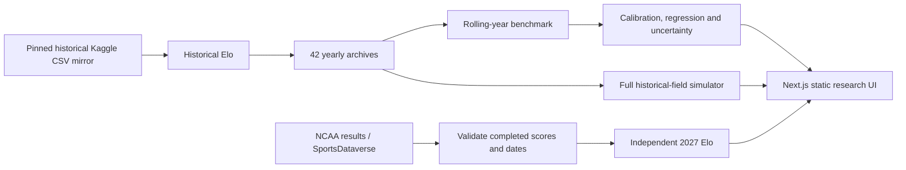

# MARCH FORECAST

## College basketball forecasting, with the receipts.

[](https://github.com/dokeefe414/March-Madness-Forecasting/actions/workflows/ci.yml)
[](https://github.com/dokeefe414/March-Madness-Forecasting/actions/workflows/deploy-pages.yml)


**[OPEN MARCH FORECAST](https://dokeefe414.github.io/March-Madness-Forecasting/)** · [Research methods](docs/validation.md) · [Data sources](docs/current-season.md) · [Bracket engine](docs/bracket-engine.md)

March Forecast is a public, responsive men's college basketball analytics and prediction research platform. It brings together historical tournaments, a real 2026–27 NCAA-source results feed, transparent team-strength estimates, holdout-year model validation and deterministic tournament simulations. **We never make up games, official seeds or forecasts to fill gaps in data.**

> **2027 is a new era:** The NCAA men's tournament will expand to **76 teams** with **12 Opening Round games** before the traditional 64-team bracket. The team field will not be officially selected until **Sunday, March 14, 2027**. [Source: NCAA](https://www.ncaa.com/news/basketball-men/article/2026-05-07/how-2027-expanded-ncaa-tournament-and-march-madness-brackets-will-work).

## Explore the platform

| Workspace | What works | Important boundary |
| --- | --- | --- |
| **2027 Pulse** | Updated current-season Elo rankings, actual final scores, form changes, margin-per-game, matchup probabilities and a sequential pregame model scorecard | NCAA-derived results published by SportsDataverse; **not** official NCAA power rankings or live play-by-play |
| **Historical Rankings** | All 42 seasons 1985–2026, team search, sort, season selector and rating timelines | 2026 regular-season mirror is incomplete |
| **Matchup Lab** | Compare historical teams using frozen Elo-based probabilities | No injury, lineup, travel or possession adjustment |
| **Bracket Lab** | Historical official seeded 64/65/68-team fields, opening rounds and all six advancement stages | Known historical entrants; generic Final Four region crossover scenario |
| **Research Lab** | Five methods, reliability charts, per-year Brier/log-loss/accuracy, paired whole-season bootstrap intervals | Conditions on *actual historical matchups*; no claimed 2027 selection odds |
| **Tournament Archive** | Historical NCAA results, champions, source coverage and held-out diagnostics | 2020 canceled, 2026 supplemental main draw excludes First Four |

The bracket engine also accepts a verified **76-team** field with 12 Opening Round slots; it will not invent a field or seed allocations ahead of selection.

## Technology and scientific foundation

- **Historical archive:** 198,079 sourced men's regular-season games across 1985–2026; 2,585 official Kaggle-format NCAA tournament results through 2025, plus 63 independently sourced 2026 main-draw results with explicitly incomplete First Four data.
- **Elo model:** starts each team at 1500 every season, `K=24`, home advantage 65 Elo points, bounded recent five-game trend.
- **Rolling benchmark:** evaluate later NCAA tournament seasons using frozen regular-season data; fit probability temperature and regularized logistic regression using **previous years only**.
- **Logistic features:** pre-tournament Elo difference, recent form adjustment, and regular-season win percentage. These are not pace-adjusted offensive/defensive possession statistics.
- **Uncertainty:** favorite reliability bins and reproducible 2,000-replicate *season-block* bootstrap intervals for Brier error differences.
- **Current season:** `stats.ncaa.org` → SportsDataverse NCAA basketball data release → strict standard-library Python importer → separated 2027 Elo → static web. Source freshness displayed as last included game date and UTC retrieval time.
- **Tournament:** four sourced regions of 16 main-draw seed positions, optionally paired play-in teams, seeded Monte Carlo 1k/5k/20k runs and full advancement probabilities.
- **Stack:** Python standard library, Next.js 16, React 19, TypeScript, pure CSS, GitHub Actions and static GitHub Pages. No paid APIs or accounts are required.

## Architecture at a glance



**Different sources, different identity spaces:** the NCAA 2027 schedule uses name-derived `ncaa-` IDs; historical Kaggle snapshots use numerical IDs. The system intentionally does not infer a false crosswalk.

## Getting started on Windows

Requires Python 3.11+, Node.js 22, npm and Git. From PowerShell (VS Code terminal):

```powershell
git clone https://github.com/dokeefe414/March-Madness-Forecasting.git
cd March-Madness-Forecasting
$env:PYTHONPATH="research"

# Repeatable checks and current data
py -m unittest discover -s research/tests -v
py -m forecast.benchmark --out web/public/research/benchmark.json
py -m forecast.live --out web/public/current/2027.json

cd web
npm install
npm run check:data
npm run test:bracket
npm run typecheck
npm run dev
```

Open [localhost:3000](http://localhost:3000). To generate the static production site, `npm run build` in `web`. On Linux/macOS, use `python3` and `export PYTHONPATH=research`.

The latest current-season feed requires an internet connection when you **generate** it, but the historical archives and tests are committed and can be inspected offline. If generated reports are not present, the frontend shows an honest unavailable status instead of silently displaying mock games.

## Reproduce a historical model comparison

```powershell
$env:PYTHONPATH="research"
py -m forecast.benchmark --web-dir web --out research/outputs/rolling-benchmark.json
```

The JSON includes aggregate and season-by-season Brier/log-loss/accuracy, training-year cutoffs, model coefficients and temperatures, favorite reliability bin sizes and 95% paired season-bootstrap intervals. **Lower Brier is better**; a negative difference against Elo is an improvement on the measured historical test set, not proof of future superiority.

The historical source itself can be rebuilt independently:

```powershell
$env:PYTHONPATH="research"
py -m forecast.download --out-dir research/data/raw
py -m forecast.history --data-dir research/data/raw --out-dir web --default-season 2025
cd web
npm run check:data
```

The downloader verifies pinned Git blob SHAs before using data. See [data contract](docs/data-contract.md) and [validation methodology](docs/validation.md).

## Publishing and 2027 data updates

The Pages workflow is configured to rebuild both generated reports on **main pushes**, **manual dispatch**, and **best-effort daily at 14:22 UTC in November–April**. The current data source is the SportsDataverse [`ncaa_mbb_schedule_2027.csv.gz` release](https://github.com/sportsdataverse/sportsdataverse-data/releases/tag/ncaa_mbb_schedule), derived from NCAA statistics. Strict validation rejects conflicting contests, negative scores, future dates and games after Selection Sunday; scoreboards with missing, zero or tied scores are excluded as not confirmed finals. An unreachable or invalid upstream file **fails deployment instead of generating fictitious scores**; the previous successful deployed site remains published.

Two reports are **generated at deployment, not committed as stale daily data**:

```text
web/public/current/2027.json            confirmed result-derived ratings
web/public/research/benchmark.json       reproducible historical evaluation
```

If the webpage is not available, ensure **Settings → Pages → Source: GitHub Actions** and inspect [deployment runs](https://github.com/dokeefe414/March-Madness-Forecasting/actions/workflows/deploy-pages.yml). See [operator runbook](docs/operations.md).

## Project organization

```text
research/forecast/
  core.py             Chronological Elo and baseline simulations
  advanced.py         L2-regularized logistic probability model
  benchmark.py        Out-of-time benchmarks, calibration and bootstrap
  live.py             Strict 2026–27 NCAA-derived final-score import
  download.py         Pinned historical data verification
  history.py          Historical season and tournament snapshots
  cli.py              Research command-line interface
research/tests/       Offline regression tests for all research systems
web/components/
  Dashboard.tsx       App shell, historical rankings, matchups, archive
  LiveSeason.tsx      Current-season team ratings and recent results
  ResearchLab.tsx     Calibration charts and held-out model comparisons
  FullBracketLab.tsx  Interactive historical full-field simulation
web/lib/fullBracket.ts  64/65/68/76-field validation and seeded Monte Carlo
web/scripts/            Bracket tests and historical data checks
web/public/seasons/     Committed historical ratings
web/public/tournaments/ Committed historical outcomes and seeds
docs/                   Architecture, data, math, design, operations
.github/workflows/       CI, daily/static deploy, archival rebuild
```

## Documentation directory

| Topic | Deep dive |
|---|---|
| Model mathematics, leakage boundary, calibration and uncertainty | [docs/validation.md](docs/validation.md) |
| Real 2027 data source, schema and refresh behavior | [docs/current-season.md](docs/current-season.md) |
| Historic 64/65/68 and future 76-team bracket structure | [docs/bracket-engine.md](docs/bracket-engine.md) |
| Architecture and data lineage | [docs/architecture.md](docs/architecture.md) |
| Historical and current JSON contracts | [docs/data-contract.md](docs/data-contract.md) |
| Design tokens, responsiveness and accessibility | [docs/design-system.md](docs/design-system.md) |
| CI, publishing, runbooks and incident handling | [docs/operations.md](docs/operations.md) |
| Detailed Python research usage | [research/README.md](research/README.md) |
| Earlier held-out tournament baseline specification | [docs/rolling-benchmark.md](docs/rolling-benchmark.md) |

## Known scientific limits

This is a research platform, **not** an official selection forecast, a possession-adjusted efficiency system, an injury-aware model, or a proven real-time 2027 tournament predictor. The current NCAA-derived source may lag the latest score. In-season games include opponents in the source that may not all be Division I. Archived 2026 ratings stop at day 118. Historical known matchups do not measure bracket selection quality, and historical semifinal pairings are approximated for cross-region simulations.

The goal is to make predictions testable and reproducible while improving the model responsibly.

---

**Open research, visible assumptions, readable code.** Verified issues, documentation improvements and contributions are welcome.
